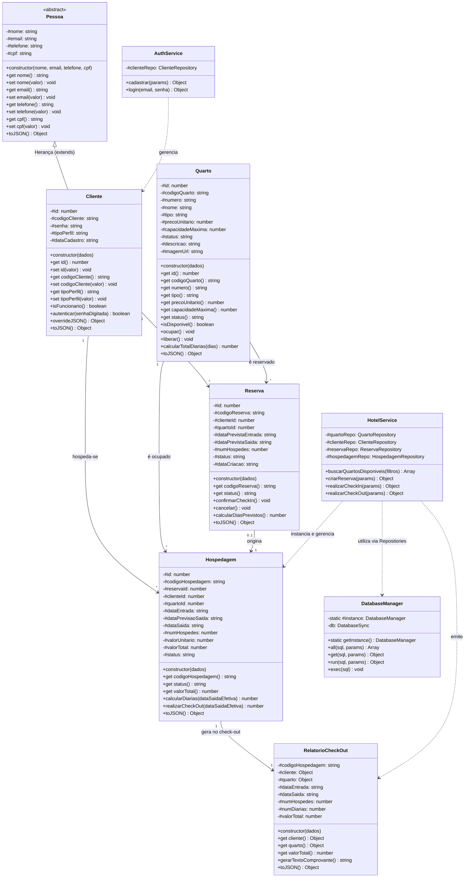

# DOCUMENTAÇÃO TÉCNICA E DE PROGRAMAÇÃO ORIENTADA A OBJETOS (POO)

**DISCIPLINA: PROGRAMAÇÃO ORIENTADA A OBJETOS II**  
**PROJETO: HOTEL VIGILANT (SISTEMA WEB & PWA COM SQLITE)**  

---

## 1. Justificativa Técnica da Linguagem e Atendimento ao Requisito 6.2

> **Atendimento ao Requisito 6.2 do Edital:**  
> *"Caso o trabalho seja implementado em outra linguagem de programação diferente de JAVA e C++, o mesmo deve conter documentação detalhada extra sobre as fases de implementação."*

O sistema **Hotel Vigilant** foi desenvolvido utilizando **JavaScript Moderno (Node.js ES2022+ no backend e ECMAScript Modules no frontend)** com persistência em banco relacional **SQLite**. A escolha por este ecossistema justifica-se por:

1. **Suporte Nativo a Classes e Encapsulamento Forte:** Desde o padrão ES2022, o JavaScript oferece suporte a campos privados nativos em nível de engine utilizando o prefixo cerquilha (`#propriedade`), proporcionando encapsulamento rígido comparável aos modificadores `private` de Java e C++.
2. **Arquitetura Web & PWA (Progressive Web App):** Permite uma interface rica, responsiva e instalável tanto em computadores quanto em dispositivos móveis, com suporte offline via Service Workers e impressão nativa de comprovantes.
3. **Persistência Relacional com SQLite Embutido (`node:sqlite`):** Banco de dados relacional leve, autônomo, compatível com SQL padrão ANSI e integridade referencial por chaves estrangeiras (`PRAGMA foreign_keys = ON;`), sem requerer a instalação de servidores pesados de banco de dados.

### Fases de Implementação do Projeto:

```
[Fase 1: Levantamento & DDL SQLite] ──> [Fase 2: Modelos POO & Encapsulamento] 
                                                        │
[Fase 5: Interface Web & PWA] <── [Fase 4: Serviços & API] <── [Fase 3: Repositories]
```

* **Fase 1: Modelagem Conceitual e Banco SQLite:** Criação do script DDL relacional (`schema.sql`), índices de busca e população inicial de dados mockados (`seed.sql`).
* **Fase 2: Modelagem Orientada a Objetos:** Implementação das classes puras do domínio hoteleiro (`Pessoa`, `Cliente`, `Quarto`, `Reserva`, `Hospedagem`, `RelatorioCheckOut`), aplicando encapsulamento rígido e herança.
* **Fase 3: Camada de Acesso a Dados (Repositories):** Aplicação do padrão Singleton no `DatabaseManager` e isolamento de operações SQL através do padrão Repository (`ClienteRepository`, `QuartoRepository`, `ReservaRepository`, `HospedagemRepository`).
* **Fase 4: Camada de Negócio e Serviços (Services):** Criação de `HotelService` e `AuthService` para orquestração de regras de negócio (validação de capacidade, tolerância de diárias, bloqueio de quartos e emissão de comprovantes).
* **Fase 5: Apresentação Web & PWA:** Construção da interface com divisão de áreas (*Área do Cliente* vs *Área do Funcionário*), manifesto PWA, Service Worker e folha de estilos limpa e profissional.

---

## 2. Diagrama de Classes Completo (Mermaid)

O diagrama abaixo ilustra a arquitetura orientada a objetos do sistema, exibindo entidades de domínio, repositórios, serviços e seus relacionamentos:



---

## 3. Os 4 Pilares da POO Aplicados no Código

A seguir, demonstra-se a aplicação prática de cada um dos quatro pilares fundamentais da Programação Orientada a Objetos com trechos reais extraídos da base de código:

### 3.1. Abstração
A **Abstração** consiste em isolar as características essenciais de um objeto do mundo real, ignorando detalhes supérfluos ou de infraestrutura de armazenamento.

* **Exemplo no Projeto:** A classe `Quarto` (`backend/src/models/Quarto.js`) abstrai a acomodação de um hotel, agrupando suas características (número, tipo, valor da diária, lotação) e seus comportamentos operacionais (`isDisponivel()`, `ocupar()`, `liberar()`, `calcularTotalDiarias()`):

```javascript
// Trecho de backend/src/models/Quarto.js
export class Quarto {
    #id;
    #codigoQuarto;
    #numero;
    #precoUnitario;
    #status;

    isDisponivel() {
        return this.#status === 'DISPONIVEL';
    }

    ocupar() {
        if (!this.isDisponivel()) {
            throw new Error(`O quarto ${this.#numero} não pode ser ocupado pois está ${this.#status}.`);
        }
        this.#status = 'OCUPADO';
    }

    liberar() {
        this.#status = 'DISPONIVEL';
    }

    calcularTotalDiarias(dias) {
        return Math.max(1, dias) * this.#precoUnitario;
    }
}
```

### 3.2. Encapsulamento
O **Encapsulamento** protege o estado interno dos objetos contra modificações diretas ou inconsistentes externas, expondo apenas interfaces controladas através de métodos getters, setters e validadores.

* **Exemplo no Projeto:** A classe `Hospedagem` (`backend/src/models/Hospedagem.js`) utiliza campos privados ECMAScript (`#propriedade`). O cálculo financeiro de diárias e a alteração de status são restritos ao método `realizarCheckOut()`:

```javascript
// Trecho de backend/src/models/Hospedagem.js
export class Hospedagem {
    #valorTotal = 0;
    #status = 'ATIVA';
    #dataSaida = null;

    // Getter expõe somente leitura do valor total
    get valorTotal() {
        return this.#valorTotal;
    }

    // Regra de negócio encapsulada: impossível calcular check-out de estadia já finalizada
    realizarCheckOut(dataSaidaEfetiva) {
        if (this.#status === 'FINALIZADA') {
            throw new Error('Esta hospedagem já se encontra finalizada.');
        }

        const dias = this.calcularDiarias(dataSaidaEfetiva);
        this.#valorTotal = dias * this.valorUnitario;
        this.#status = 'FINALIZADA';
        this.#dataSaida = dataSaidaEfetiva;

        return this.#valorTotal;
    }
}
```

### 3.3. Herança
A **Herança** permite reaproveitar atributos e comportamentos de uma superclasse genérica em uma subclasse especializada, evitando duplicação de código.

* **Exemplo no Projeto:** A classe `Cliente` (`backend/src/models/Cliente.js`) herda diretamente da classe base `Pessoa` (`backend/src/models/Pessoa.js`) através da palavra-chave `extends`, invocando o construtor pai via `super()`:

```javascript
// Trecho de backend/src/models/Pessoa.js
export class Pessoa {
    #nome;
    #email;
    #telefone;
    #cpf;

    constructor(nome, email, telefone = '', cpf = '') {
        this.#nome = nome;
        this.#email = email;
        this.#telefone = telefone;
        this.#cpf = cpf;
    }
    // getters e setters de Pessoa...
}

// Trecho de backend/src/models/Cliente.js
import { Pessoa } from './Pessoa.js';

export class Cliente extends Pessoa {
    #id;
    #codigoCliente;
    #senha;
    #tipoPerfil;

    constructor({ id, codigoCliente, nome, email, senha, telefone, cpf, tipoPerfil = 'CLIENTE' }) {
        // Invocação da superclasse Pessoa
        super(nome, email, telefone, cpf);
        this.#id = id;
        this.#codigoCliente = codigoCliente;
        this.#senha = senha;
        this.#tipoPerfil = tipoPerfil;
    }

    autenticar(senhaDigitada) {
        return this.#senha === senhaDigitada;
    }
}
```

### 3.4. Polimorfismo
O **Polimorfismo** permite que métodos com a mesma assinatura apresentem comportamentos distintos conforme a classe do objeto que os implementa (sobrescrita de método / method overriding).

* **Exemplo no Projeto:** A superclasse `Pessoa` implementa `toJSON()` para expor os dados básicos de uma pessoa física. A subclasse `Cliente` sobrescreve `toJSON()` através de `overrideJSON()`, incorporando `id`, `codigoCliente`, `tipoPerfil` e mantendo a chamada a `super.toJSON()`:

```javascript
// Em Pessoa.js:
toJSON() {
    return {
        nome: this.nome,
        email: this.email,
        telefone: this.telefone,
        cpf: this.cpf
    };
}

// Em Cliente.js (Sobrescrita polimórfica):
overrideJSON() {
    return {
        id: this.id,
        codigoCliente: this.codigoCliente,
        tipoPerfil: this.tipoPerfil,
        ...super.toJSON(), // reaproveitamento polimórfico do pai
        dataCadastro: this.dataCadastro
    };
}

toJSON() {
    return this.overrideJSON();
}
```

---

## 4. Padrões de Projeto (Design Patterns)

### 4.1. Singleton Pattern (`DatabaseManager.js`)
Garante que exista uma **única instância** ativa do gerenciador de banco de dados SQLite em toda a aplicação, centralizando a integridade das transações e evitando locks concorrentes.

```javascript
export class DatabaseManager {
    static #instance = null;

    static getInstance() {
        if (!DatabaseManager.#instance) {
            DatabaseManager.#instance = new DatabaseManager();
        }
        return DatabaseManager.#instance;
    }
}
```

### 4.2. Repository Pattern (DAO)
Separa completamente as instruções SQL (INSERT, SELECT, UPDATE) das regras de negócio do hotel:
- `ClienteRepository.js`: Localiza clientes por código, e-mail e gera identificadores sequenciais `CLI-100X`.
- `QuartoRepository.js`: Realiza buscas com filtros e atualiza status de ocupação.
- `ReservaRepository.js`: Gerencia agendamentos e vinculações.
- `HospedagemRepository.js`: Persiste o check-in e consolida o relatório de check-out.

### 4.3. Service Layer Pattern
Centraliza as operações de alto nível em `HotelService` e `AuthService`, mantendo os controladores HTTP (`HotelController.js`) focados apenas no transporte de requisições e respostas REST.

---

## 5. Padrão JSDoc / TSDoc (Atendimento ao Requisito 5.1)

> **Atendimento ao Requisito 5.1 do Edital:**  
> *"Código-fonte devidamente documentado (Padrão Javadoc ou equivalente)."*

Como o projeto foi implementado em JavaScript/Node.js, adotou-se o padrão **JSDoc/TSDoc**, que é o padrão oficial equivalente ao Javadoc para o ecossistema JavaScript e TypeScript. Todos os métodos centrais de negócio foram documentados com descrição detalhada, `@param`, `@returns`, `@throws` e exemplos de uso (`@example`).

### Exemplos dos Métodos Centrais:

#### A. Cadastro de Usuário (Requisito 3.1)
```javascript
/**
 * Cadastro de novo usuário/cliente no sistema (Requisito 3.1).
 * Cria uma nova entidade Cliente herdada de Pessoa, gerando código único `CLI-XXXX`.
 *
 * @param {Object} params - Dados de cadastro do cliente.
 * @param {string} params.nome - Nome completo do cliente/hóspede.
 * @param {string} params.email - Endereço eletrônico único do cliente.
 * @param {string} params.senha - Senha para autenticação no sistema.
 * @param {string} [params.telefone=''] - Número de telefone para contato.
 * @param {string} [params.cpf=''] - CPF do cliente para identificação.
 * @param {'CLIENTE'|'FUNCIONARIO'} [params.tipoPerfil='CLIENTE'] - Perfil de acesso ao sistema.
 * @returns {{ sucesso: boolean, mensagem: string, cliente: Object }} Confirmação e dados públicos.
 * @throws {Error} Lança exceção se dados obrigatórios estiverem ausentes ou e-mail já existir.
 */
cadastrar({ nome, email, senha, telefone, cpf, tipoPerfil = 'CLIENTE' })
```

#### B. Criação de Reserva (Requisitos 3.2 e 3.3)
```javascript
/**
 * Requisito 3.2 e 3.3: Efetuar reserva de quarto vinculando cliente e acomodação.
 * Valida a capacidade máxima do quarto, coerência de datas e gera código único no formato `RES-XXXX`.
 *
 * @param {Object} params - Dados da solicitação de reserva.
 * @param {string} params.codigoCliente - Código do cliente cadastrado (Ex: 'CLI-1001').
 * @param {string} params.codigoQuarto - Código ou número da acomodação (Ex: 'Q-101').
 * @param {string} params.dataPrevistaEntrada - Data de início pretendida no formato YYYY-MM-DD.
 * @param {string} params.dataPrevistaSaida - Data de término pretendida no formato YYYY-MM-DD.
 * @param {number|string} params.numHospedes - Quantidade de ocupantes da reserva.
 * @returns {{ sucesso: boolean, mensagem: string, codigoReserva: string, reserva: Object }} Confirmação.
 * @throws {Error} Lança exceção se cliente/quarto não existirem ou capacidade excedida.
 */
criarReserva({ codigoCliente, codigoQuarto, dataPrevistaEntrada, dataPrevistaSaida, numHospedes })
```

#### C. Efetivação do Check-in com os 5 Campos Obrigatórios (Requisito 3.3)
```javascript
/**
 * Requisito 3.3: Realização do Check-in (Entrada de Hóspede).
 * Exige os 5 dados obrigatórios do edital:
 * 1. Código do cliente
 * 2. Código do item (quarto)
 * 3. Data e hora de entrada
 * 4. Data de previsão de saída
 * 5. Número de hóspedes
 * (Opcional: código de reserva prévia para vinculação).
 *
 * @param {Object} params - Parâmetros obrigatórios de entrada.
 * @param {string} params.codigoCliente - Código do cliente hóspede (Ex: 'CLI-1001').
 * @param {string} params.codigoItem - Código ou número da acomodação (Ex: 'Q-101').
 * @param {string} params.dataEntrada - Data e hora de check-in (ISO 8601).
 * @param {string} params.dataPrevisaoSaida - Data prevista para encerramento (YYYY-MM-DD).
 * @param {number|string} params.numHospedes - Quantidade de pessoas que ocuparão o quarto.
 * @param {string} [params.codigoReserva=null] - Código de reserva prévia vinculada (Ex: 'RES-8041').
 * @returns {{ sucesso: boolean, mensagem: string, codigoHospedagem: string }} Confirmação de ocupação.
 * @throws {Error} Lança exceção se dados faltarem, quarto não estiver disponível ou capacidade exceder.
 */
realizarCheckIn({ codigoCliente, codigoItem, dataEntrada, dataPrevisaoSaida, numHospedes, codigoReserva = null })
```

#### D. Realização do Check-out com Comprovante [a]-[f] (Requisito 3.4)
```javascript
/**
 * Requisito 3.4: Realização do Check-out e Emissão do Relatório Oficial.
 * Calcula o total de diárias consumidas (mínimo de 1), encerra a hospedagem, libera o quarto
 * e formata o comprovante formal com os 6 itens obrigatórios do edital:
 * - [a] Nome e código do cliente
 * - [b] Número do quarto, tipo e valor unitário (diária)
 * - [c] Data de entrada
 * - [d] Data de saída
 * - [e] Número de hóspedes
 * - [f] Valor total a pagar
 *
 * @param {Object} params - Identificadores da estadia.
 * @param {number} [params.id] - Identificador primário numérico da hospedagem.
 * @param {string} [params.codigoHospedagem] - Código da estadia (Ex: 'HOSP-1001').
 * @param {string} [params.dataSaida=null] - Data e hora de encerramento efetivo (padrão: agora).
 * @returns {{ sucesso: boolean, mensagem: string, relatorio: Object }} Comprovante consolidado.
 * @throws {Error} Lança exceção se a hospedagem não existir ou já tiver sido finalizada.
 */
realizarCheckOut({ id, codigoHospedagem, dataSaida = null })
```

---

## 6. Matriz de Rastreabilidade dos Requisitos do Edital

| Item do Edital | Exigência Acadêmica | Implementação Técnica no Código |
| :--- | :--- | :--- |
| **3.1** | Cadastro de usuário para acesso às opções do sistema. | `Pessoa.js`, `Cliente.js`, `ClienteRepository.create()`, `AuthService.cadastrar()`. Geração automática de `CLI-100X`. |
| **3.2** | Login e busca de quartos com **nome, tipo, preço e código para reserva**. | `Quarto.js`, `QuartoRepository.findDisponiveis()`, endpoint `GET /api/quartos/disponiveis`. A interface exibe nome, categoria, diária (R$) e código `Q-XXX`. |
| **3.3** | Efetuar reserva por código e realizar check-in com: código do cliente, código do quarto, data de entrada, previsão de saída e nº de hóspedes. | `Reserva.js`, `Hospedagem.js`, `HotelService.realizarCheckIn()`, endpoint `POST /api/hospedagens/checkin`. O quarto é automaticamente atualizado para `OCUPADO`. |
| **3.4** | Check-out com emissão de relatório contendo:<br>a. Nome e código do cliente<br>b. Número do quarto, tipo e valor unitário<br>c. Data de entrada<br>d. Data de saída<br>e. Número de hóspedes<br>f. Valor total | `RelatorioCheckOut.js`, `HospedagemRepository.obterRelatorioCheckOut()`, endpoint `POST /api/hospedagens/checkout`. Modal e impressão de comprovante com os itens [A] ao [F]. |
| **4.1** | Base de dados relacional. | **SQLite** (`backend/src/database/vigilant.db`) com constraints de chave estrangeira (`PRAGMA foreign_keys = ON;`). |
| **4.2** | Paradigma Orientado a Objetos (POO). | Modelagem em classes, encapsulamento (`#atributos`), herança (`Cliente extends Pessoa`), polimorfismo, Singleton e Repository Pattern. |
| **5.1** | Código documentado no padrão Javadoc ou equivalente. | Comentários no padrão **JSDoc/TSDoc** em todos os métodos públicos de classes e serviços de negócio. |
| **6.2** | Documentação detalhada extra em caso de linguagem diferente de Java/C++. | Esta documentação técnica detalhada, justificando e demonstrando a arquitetura em camadas e os 4 pilares da POO. |

---

## 7. Instruções para Execução e Testes

```bash
# 1. Instalação das dependências
npm install

# 2. Inicialização do banco de dados com dados mockados (Seed)
npm run seed

# 3. Execução dos testes automatizados de conformidade
npm test

# 4. Inicialização do servidor Web & PWA
npm start
```

Aplicação disponível no navegador em: **http://localhost:3002**
